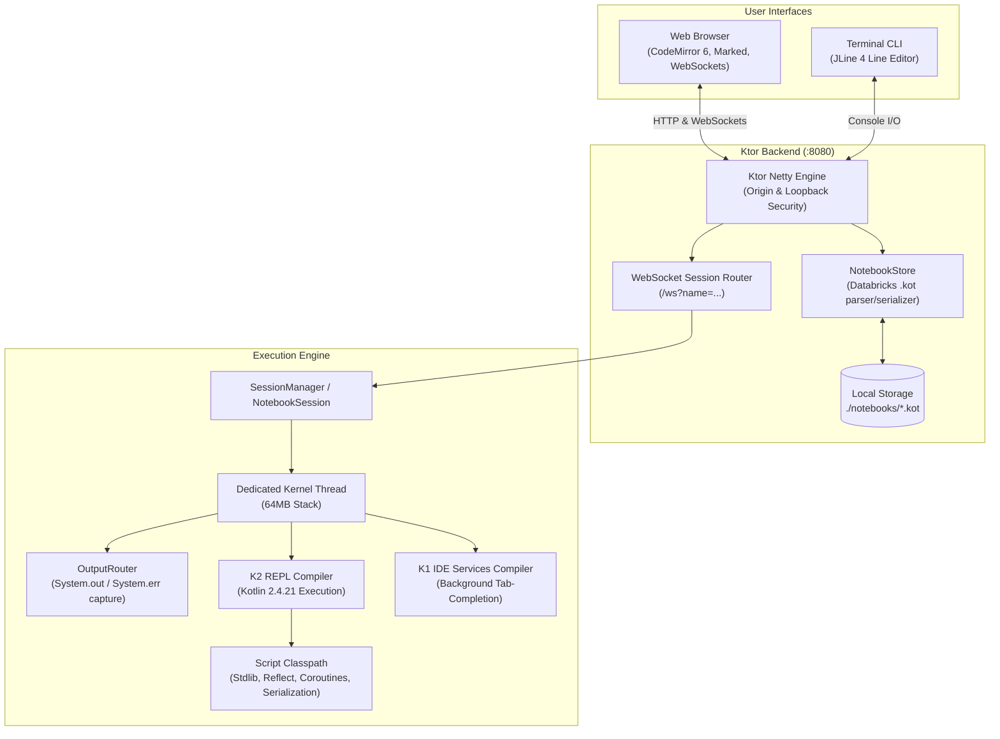

# Kotlin Notebook

[](https://kotlinlang.org/)
[](https://openjdk.org/)
[](https://ktor.io/)
[](https://codemirror.net/)
[](LICENSE)
[](CONTRIBUTING.md)

An interactive, lightweight Kotlin web notebook and command-line REPL. Both run code in-process using the modern Kotlin 2.4 K2 compiler frontend, providing immediate language feedback, rich HTML rendering, and full Databricks-compatible notebook persistence.

---

## Architecture Overview



---

## Key Features

- **Interactive Web Notebook**: Clean, responsive browser notebook UI built with CodeMirror 6 and Marked. Supports IntelliJ Light and Darcula dark themes.
- **Full Kotlin 2.4 Support**: Evaluates snippets with the official K2 REPL compiler (`K2ReplCompiler` and `K2ReplEvaluator`), enabling language features through Kotlin 2.4+.
- **Terminal CLI REPL**: Scala-style interactive terminal REPL built on JLine 4 with multi-line continuous input, syntax highlighting via the compiler's lexer, tab completion, and command history (`~/.kotlin_notebook_history`).
- **Databricks Compatibility**: Notebooks are saved in `.kot` format, fully adhering to the Databricks notebook source standard (`// COMMAND ----------`, `// MAGIC %md`). Notebooks exported from Databricks open seamlessly.
- **Version Control Friendly**: Outputs and volatile runtime states are not stored in `.kot` files, keeping git diffs completely clean.
- **Rich Output & HTML**: Display formatted HTML, diagrams, and tables directly inside notebook cells using the built-in `html("...")` API.
- **Dynamic Dependency Loading**: Pull in external Maven artifacts at runtime using `@file:DependsOn("group:artifact:version")` and custom registries with `@file:Repository("https://...")`.
- **Zero External Network Dependencies**: Bundled frontend JavaScript assets (`vendor.js`) allow the application to function 100% offline.
- **Built-in Security**: Binds to `127.0.0.1` by default and enforces strict origin validation to protect against cross-site request attacks.

---

## Prerequisites

- **Java Development Kit (JDK)**: JDK 21 LTS or higher is required. Verify your setup:
  ```bash
  java -version
  ```
- **Operating System**: Linux, macOS, or Windows (includes automated Windows trust store integration for corporate TLS proxies).

---

## Quick Start

### 1. Build the Project

Use the included Gradle wrapper to build the distribution binaries:

```bash
./gradlew installDist
```

Or assemble a single, self-contained executable fat JAR (includes all dependencies):

```bash
./gradlew shadowJar
```

### 2. Launch the Application

#### Option A: Web Notebook Server

Start the local notebook server (defaults to `http://localhost:8080`):

```bash
# Using installed distribution binary
build/install/kotlin-notebook/bin/kotlin-notebook serve

# Or using the fat JAR
java -jar build/libs/kotlin-notebook-0.1.0-all.jar serve

# Or directly through Gradle
./gradlew run --args="serve"
```

Open your browser to [http://localhost:8080](http://localhost:8080) to access the notebook UI.

#### Option B: Interactive CLI REPL

Run the terminal-based REPL:

```bash
# Using installed distribution binary
build/install/kotlin-notebook/bin/kotlin-notebook

# Or using the fat JAR
java -jar build/libs/kotlin-notebook-0.1.0-all.jar
```

Piped input is also supported:

```bash
echo 'listOf(1, 2, 3, 4, 5).sum()' | build/install/kotlin-notebook/bin/kotlin-notebook
```

---

## Command-Line Configuration

The `serve` command accepts several options to customize ports, host bindings, and notebook storage:

| Option | Default | Description |
|---|---|---|
| `--port <number>` | `8080` | HTTP port for the web server. |
| `--host <address>` | `127.0.0.1` | Network interface to bind. Only bind to `0.0.0.0` on trusted networks. |
| `--notebooks <path>` | `./notebooks` | Directory holding `.kot` notebook files (relative or absolute). |
| `-h`, `--help` | — | Display command usage and flag descriptions. |

Example running on a custom port with a specific notebooks folder:

```bash
build/install/kotlin-notebook/bin/kotlin-notebook serve --port 9000 --notebooks /path/to/my/notebooks
```

> [!CAUTION]
> Notebook cells execute arbitrary code with the permissions of the running process. The server binds strictly to `127.0.0.1` and rejects non-local CORS/Origin headers. Never expose `--host 0.0.0.0` on an untrusted or public network.

---

## CLI REPL Guide

The CLI REPL provides a responsive terminal environment modeled on the Scala REPL:

```kotlin
Welcome to Kotlin 2.4.21 (Java 21.0.12.1+1-LTS, OpenJDK 64-Bit Server VM).
Type in expressions for evaluation. Or try :help.

kotlin> fun twice(n: Int) =
      |     n * 2
kotlin> twice(21)
res2: Int = 42
kotlin> res2 + missing
error: Unresolved reference 'missing'.
  res2 + missing
         ^^^^^^^
```

- **Multi-line Continuation**: Incomplete expressions (such as open braces or trailing operators) automatically open a continuation prompt (`|`). Press **Enter** on two consecutive blank lines to force submission and display syntax diagnostics.
- **Result Indexing**: Values are automatically assigned to `res1`, `res2`, etc., and can be referenced in subsequent commands.
- **Tab Completion**: Press <kbd>Tab</kbd> to inspect available members, methods, and keywords. Overloads are listed with full function signatures.
- **Signals**: <kbd>Ctrl+C</kbd> interrupts a running computation or clears the current prompt line. <kbd>Ctrl+D</kbd> exits.
- **REPL Commands**:
  - `:help` or `:?`: Show help instructions.
  - `:load <file.kts or notebook.kot>`: Load declarations from an external script or notebook.
  - `:reset`: Reset the REPL state and kernel compiler.
  - `:quit` or `:q`: Terminate the REPL session.
- **Persistent History**: Shell history is automatically preserved across sessions in `~/.kotlin_notebook_history`.

---

## Notebook Web UI & Shortcuts

| Shortcut | Description |
|---|---|
| <kbd>Shift</kbd> + <kbd>Enter</kbd> | Run the active cell and select the cell below. |
| <kbd>Ctrl</kbd> + <kbd>Enter</kbd> | Run the active cell in place. |
| <kbd>Alt</kbd> + <kbd>Enter</kbd> | Run the active cell and insert a new cell directly below. |
| <kbd>Ctrl</kbd> + <kbd>Space</kbd> | Trigger autocompletion list (completions also appear as you type). |
| <kbd>Tab</kbd> / <kbd>Enter</kbd> | Accept highlighted autocomplete suggestion. |
| <kbd>Up</kbd> / <kbd>Down</kbd> | Navigate between adjacent cells (at the first or last line of the editor). |
| <kbd>Ctrl</kbd> + <kbd>S</kbd> | Force save notebook (cells auto-save on change). |

### Key Cell Capabilities

1. **Shared Notebook Session**: Cells share declarations within each notebook session. Variables, classes, and functions declared in earlier cells are directly accessible in later cells.
2. **Interrupt & Restart**: Click **Interrupt** to halt execution of a long-running cell, or **Restart** to clear session memory and start a fresh kernel.
3. **Execution Queue**: If an upstream cell fails, subsequent queued cells are aborted to prevent cascading runtime errors.
4. **Markdown Support**: Toggle cells to Markdown to embed rich notes, headings, and formulas. Double-click a rendered cell to edit its markdown source.
5. **HTML Display API**: Return `html("<div>...</div>")` from any cell to render raw HTML, tables, and SVG graphics directly in the output pane:
   ```kotlin
   html("""
       <div style="background: #2b2b2b; color: #a9b7c6; padding: 12px; border-radius: 6px;">
           <h3>Execution Metrics</h3>
           <p>Processed <b>1,000,000</b> records in 42ms.</p>
       </div>
   """)
   ```
6. **External Maven Dependencies**: Download and link external libraries on the fly using scripting annotations:
   ```kotlin
   @file:DependsOn("com.google.guava:guava:33.0.0-jre")
   import com.google.common.collect.ImmutableList

   ImmutableList.of("Alpha", "Beta", "Gamma")
   ```
   Custom Maven repositories can be registered with:
   ```kotlin
   @file:Repository("https://packages.confluent.io/maven/")
   ```

---

## Notebook File Format (`.kot`)

Notebooks are saved as standard text files adhering to the Databricks notebook format:

```kotlin
// Kotlin notebook source
val greeting = "Hello, world!"
println(greeting)

// COMMAND ----------

// MAGIC %md
// MAGIC # Analysis Section
// MAGIC Detailed notes explaining the data pipeline.

// COMMAND ----------

val numbers = listOf(1, 2, 3, 4, 5)
numbers.map { it * 10 }
```

- **Native Kotlin**: Standard Kotlin cells are written verbatim.
- **Markdown Cells**: Prefixed with `// MAGIC %md`.
- **Ambiguity Handling**: Any Kotlin cell containing separator lines or looking like magic comments is escaped as `// MAGIC %kotlin`.
- **Databricks Interop**: Notebooks exported from Databricks (`// Databricks notebook source`) open directly in Kotlin Notebook.

---

## Technical Internals

- **K2 Compiler Evaluation**: Snippets are compiled and executed using Kotlin 2.4's `K2ReplCompiler` and `K2ReplEvaluator`.
- **Hybrid Autocompletion**: Code completion utilizes `KJvmReplCompilerWithIdeServices` (Kotlin's K1 IDE completion engine). As cells run, declarations are continuously synchronized with the completion compiler so subsequent completions respect newly introduced symbols and shadowing.
- **Session Isolation**: Each open notebook runs in its own `NotebookSession` with a dedicated kernel thread (configured with a 64MB stack) and run queue.
- **Output Virtualization**: `OutputRouter` captures standard stdout and stderr streams on a per-cell basis, including messages emitted by child threads spawned by a cell.
- **Pre-indexed Classpath**: The server generates an embedded script classpath (`script-classpath.txt`) during the build so that cells see `kotlin-stdlib`, `kotlin-reflect`, `kotlinx-coroutines`, and `kotlinx-serialization` without requiring explicit `@file:DependsOn` annotations, while keeping the server's own libraries (Ktor, Netty, etc.) secluded from notebook code.

---

## Project Structure

```
kotlin-notebook/
├── build.gradle.kts          # Gradle build and shadow JAR configuration
├── settings.gradle.kts       # Gradle settings and project name
├── gradle.properties         # JVM and Gradle build settings
├── gradle/
│   ├── libs.versions.toml    # Dependency versions (Kotlin 2.4.21, Ktor 3.6.0, JLine 4.4.8)
│   └── wrapper/              # Gradle wrapper JAR and properties
├── gradlew, gradlew.bat      # POSIX and Windows Gradle execution scripts
├── notebooks/                # Default directory for .kot notebook files
│   └── Welcome.kot           # Interactive tutorial notebook
├── frontend/                 # CodeMirror 6 and Marked frontend sources
│   ├── package.json          # Node dependencies for vendored bundle
│   ├── vendor.js             # Bundled editor entry point
│   └── e2e/                  # Browser end-to-end integration tests
└── src/
    ├── main/
    │   ├── kotlin/kotnb/     # Backend implementation (Cli, Server, KotlinRepl, Format)
    │   └── resources/        # Web assets (HTML, CSS, JS, JetBrains Mono fonts)
    └── test/                 # Comprehensive JUnit 5 test suite
```

---

## Development & Testing

### Running Tests

Execute all backend unit and integration tests:

```bash
./gradlew test
```

### End-to-End Frontend Testing

The project includes headless browser tests driving the notebook UI in Chrome/Edge:

```bash
./gradlew installDist
cd frontend
npm install
npm run e2e
```

To test against the standalone fat JAR:

```bash
KOTNB_JAR=../build/libs/kotlin-notebook-0.1.0-all.jar npm run e2e
```

To run tests against Microsoft Edge instead of Chrome:

```bash
KOTNB_BROWSER=msedge npm run e2e
```

### Rebuilding Frontend Bundles

If you upgrade or modify editor dependencies in `frontend/package.json`:

```bash
cd frontend
npm install
npm run build
```

This updates the compiled bundle in `src/main/resources/static/vendor/vendor.js`.

---

## Troubleshooting & FAQ

### Port 8080 already in use
If another service is using port 8080, specify an alternative port:
```bash
./gradlew run --args="serve --port 8888"
```

### Cold start delay on first execution
Starting the Kotlin compiler kernel can take 2-4 seconds during the first cell execution or first tab completion while the JVM loads the K2 and K1 compiler jars. Subsequent evaluations and completions run with minimal latency.

### Infinite loops and cell cancellation
Cell cancellation uses `Thread.interrupt()`. Snippets stuck in tight loops that do not check thread interruption status cannot be gracefully stopped via the Interrupt button. In such cases, click **Restart** to create a fresh kernel session.

### Corporate TLS Proxies (Windows)
When running on Windows, Kotlin Notebook automatically configures the JVM to use the Windows root certificate store (`Windows-ROOT`), ensuring dynamic dependency resolution via `@file:DependsOn` functions seamlessly through enterprise inspecting proxies.

---

## Contributing

Contributions are warmly welcomed! Please check [CONTRIBUTING.md](CONTRIBUTING.md) for environment setup, testing steps, and pull request guidelines.

---

## License

This project is licensed under the [Apache License, Version 2.0](LICENSE).
